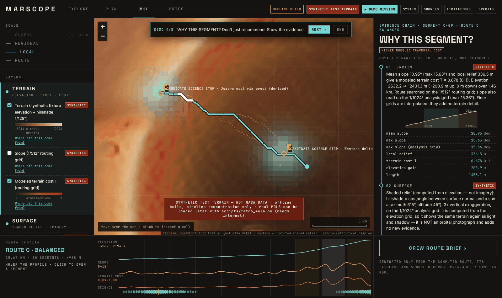

# MARSCOPE — Mission-Aware Route Intelligence for Mars

MARSCOPE is a route-planning prototype for Jezero crater on Mars, made by Team DeltaX (Dhaka) for the NASA Space Apps
Challenge 2026 (*Interplanetary Survival Guide: Martian Map*).

> **Pre-event concept prototype, not work produced during the official hackathon (Nov 14–15, 2026).**
>
> This version uses only files inside the project and downloads nothing. The terrain is a **synthetic test fixture** in
> the official MOLA file format — **not NASA data** — and the app labels it SYNTHETIC everywhere.

## Overview

MARSCOPE is a decision-support map for Jezero crater (17.85–18.90°N, 76.95–78.20°E). It is a planning aid, not a safety
system.

- Computes three routes between two points, one per mission priority: traversability-first, science-first and balanced.
  Each route is an exact least-cost path on a 1/512° grid (the 1/128° source grid can also be selected).
- **WHY?** panel: for every route segment, shows the terrain values, cost breakdown, method, data source, provenance and
  limitations behind it.
- Route profile with elevation, slope, modeled terrain cost and science proximity, linked to the map.
- Layer toggles (terrain, slope, cost, shaded relief, science proximity, shot-count coverage), each with a
  "Where did this come from?" source record.
- Printable one-page **Crew Route Brief**.
- Every layer, grid, target and brief line carries a status word: VERIFIED, DERIVED, APPROXIMATE, ASSUMPTION,
  SYNTHETIC, CONCEPTUAL or DATA_UNAVAILABLE. A result is never stronger than its weakest input.
- **▶ DEMO MISSION** walks through the app in 8 steps (≈ 2–3 min): region and layers → three routes → science-first
  route → WHY? on one segment → science stop → data sources → Crew Route Brief → system pipeline.



## Requirements and setup

- Python 3.10 or newer.
- Node.js 18 or newer, only if you want to rebuild the user interface. The built interface is already in
  `frontend/dist/`.

```bash
pip install -r requirements.txt
```

## Run

```bash
python run.py                 # starts the app at http://localhost:8000 and opens it in the browser
```

Click **▶ DEMO MISSION**, then **NEXT ›**. You can also click any map cell to inspect it, set your own start and
destination in PLAN, and switch the routing grid between 1/512° and 1/128°. Set `MARSCOPE_PORT` to use another port.

If FastAPI is not installed, `run.py` starts a Starlette-only server with the same API (Starlette, NumPy, SciPy,
Pillow, Pydantic and Uvicorn are still needed).

**Without a backend:** `cd frontend/dist && python -m http.server 8090`, then open http://localhost:8090. The app uses
the bundled Demo Mission snapshot and shows **OFFLINE SNAPSHOT**. Only the Demo Mission routes are available in this mode.

**Tests:**

```bash
python -m pytest backend/tests -q
```

**Data scripts** (no internet needed, except `fetch_mola.py`):

| Command | What it does |
|---|---|
| `python scripts/make_fixture.py` | Re-creates the synthetic terrain fixture (deterministic, seed 42) |
| `python scripts/build_region.py` | Clips the region, computes slope, relief, hillshade, grid statistics, layer images, the path slot and provenance → `data/processed/jezero/` |
| `python scripts/build_snapshot.py` | Freezes the Demo Mission API responses for the no-backend mode |
| `python scripts/check_local_data.py` | Lists which real source files are present in `data/raw/` |
| `python scripts/benchmark_routes.py` | Times route search on each grid on your computer |
| `python scripts/fetch_mola.py` | Downloads the real MOLA tiles (needs internet) |
| `python run.py --rebuild` | Runs `build_region` and `build_snapshot`, then starts the app |

With the real MOLA tiles in `data/raw/`, `python run.py --rebuild` switches the whole app to real terrain and the
SYNTHETIC banner disappears. See [docs/DATA.md](docs/DATA.md) for every intended source and where to put it.

**Develop the user interface:** `cd frontend && npm install && npm run dev` (proxies `/api` to port 8000).
`npm run build` rebuilds `frontend/dist/`.

**More documentation:** [Architecture](docs/ARCHITECTURE.md) · [Routing](docs/ROUTING.md) ·
[Data](docs/DATA.md) · [Scientific method](docs/SCIENTIFIC_METHOD.md)

## Data sources and credits

Intended data sources:

- NASA / GSFC MOLA Science Team / PDS Geosciences Node — MOLA MEGDR topography and shot counts
- USGS Astrogeology / NASA JPL — CTX DEM and orthomosaic (Mars 2020)
- NASA/JPL-Caltech — Perseverance location map (traverse and waypoints)
- Saranathan & Parente 2021, UMass Amherst — CRISM-derived Jezero map (Zenodo 5575824; third-party terms)
- NASA PDS Atmospheres Node — Mars 2020 MEDA
- IAU/USGS Gazetteer of Planetary Nomenclature

**None of these datasets is inside this build.** They are listed as intended sources. The landing site and crater
centre coordinates are published values cited in `data/targets/jezero_targets.json`. The in-app **CREDITS** panel shows
which sources are used in this build.

## Known limitations

- **No real terrain:** all terrain, slope, cost and route numbers come from the synthetic fixture. They show how the
  method works, not what Mars is like.
- The 1/512° and 1/1024° grids are interpolated from the ~463 m source grid. They give smoother routes but add no
  terrain detail, and spline overshoot can raise maximum slopes.
- The SURFACE layer is shaded relief computed from the elevation grid, not orbital imagery.
- The violet dotted line is a synthetic illustration, not the Perseverance path.
- CRISM is DATA_UNAVAILABLE; MEDA conditions and the global view are CONCEPTUAL.
- The 25° slope limit and the cost weights are ASSUMPTIONS, not measured human or rover limits. Nothing is called safe.
- The western delta front position is APPROXIMATE and has not been checked against real data.
- Route timings in the docs were measured on one cloud test machine.

## Credits

- Team DeltaX (Dhaka).
- Software: React (MIT), Leaflet (BSD-2-Clause), Vite, TypeScript, NumPy, SciPy, Pillow, Starlette / FastAPI, Uvicorn,
  Pydantic.
- Fonts: Inter, Space Grotesk and JetBrains Mono (SIL Open Font License 1.1, via Fontsource).
- MARSCOPE's own code is under the MIT licence (see [LICENSE](LICENSE)). NASA/USGS data keep their credit lines;
  third-party data keep their authors' credit and terms.